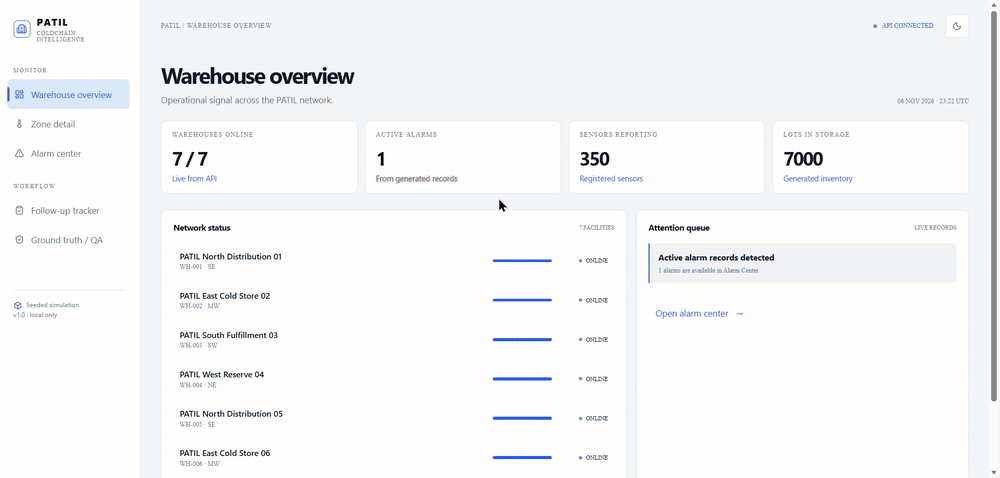
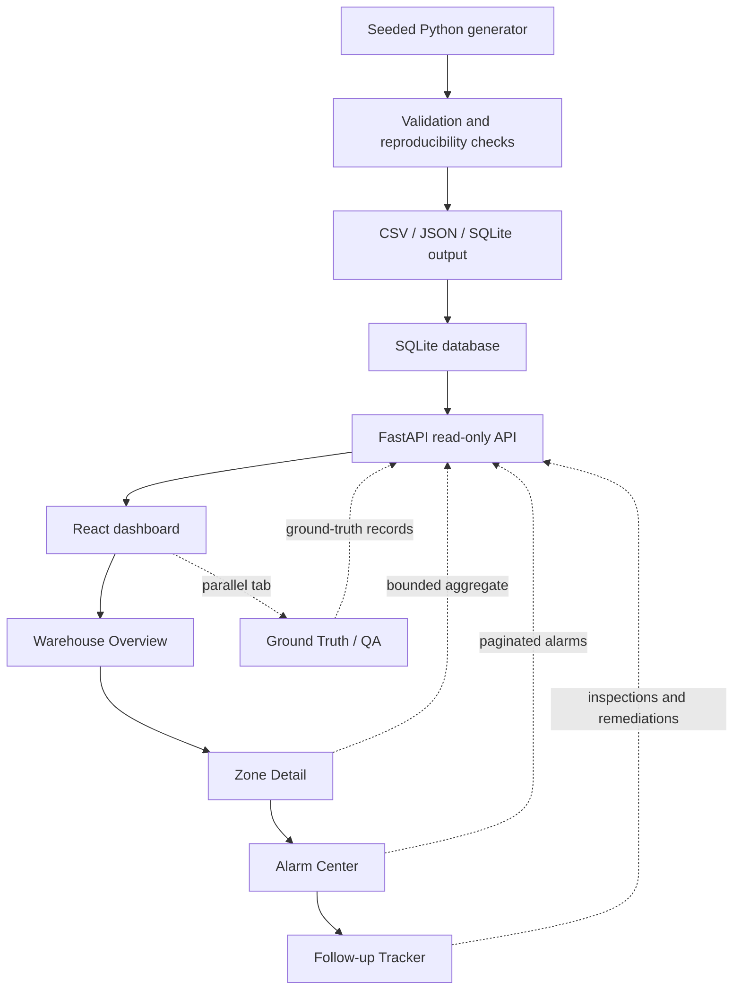
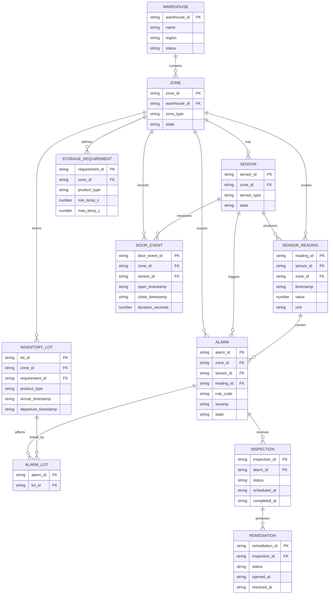

# PATIL COLDCHAIN INTELLIGENCE

Local-first warehouse monitoring simulation for warehouse operators and quality teams.

## What this is

Warehouse teams need to monitor zone temperature, humidity, occupancy, and door events, then identify when storage conditions put inventory at risk. This project builds a seeded synthetic data generator, rule-driven alarm records, a FastAPI read-only backend, and a React operations dashboard for that workflow.

## Tech stack

| Layer | Technology | Purpose |
|---|---|---|
| Data generation | Python 3.11+ | Deterministic synthetic warehouse data |
| Data modeling | Standard-library CSV, JSON, SQLite | Portable generated exports and local storage |
| Backend API | FastAPI + SQLite | Read-only, filterable, paginated API |
| Frontend | React + TypeScript + Vite | Dashboard and screen navigation |
| Styling | TailwindCSS + CSS variables | Dashboard theming |
| Charts | Recharts | Bounded telemetry visualization |
| Animation | Framer Motion | Small, purposeful interface transitions |

No API keys, cloud account, database server, or external service is required.

## Workflow

The implemented runtime flow is:



Ground Truth / QA is a separate navigation tab. GT-002 is currently an evidence-only edge case: it flags a sensor in `ground_truth.csv/json`, but the feature schema stores one `sensors.zone_id` and does not implement an effective-dated multi-zone bridge.

## Data model

The diagram below reflects the generated SQLite tables and their implemented logical relationships. `ALARM_LOT` is the many-to-many bridge table.



## Install → run → verify

### Prerequisites

- Python 3.11 or newer
- Node.js 20.19+ (or Node.js 22.12+) and npm
- Windows, macOS, or Linux
- PowerShell is used in the examples below. On macOS/Linux, replace the path separators with `/` and use the equivalent `curl` commands where noted.
- No API keys, cloud account, database server, or external service is required.

### 1. Generate and validate data

Open **Terminal 1** at the project root:

```powershell
python data-generator\generate.py --scale 0.01
python data-generator\validate.py
python data-generator\verify_reproducibility.py
```

The smoke dataset is intentionally small. Successful output includes:

```text
validation: PASS
reproducibility: PASS
```

Use `--scale 1.0` for the target dataset: 10 warehouses, 100 zones, 500 sensors, 1,000,000 readings, and 10,000 lots.

### 2. Install and start the backend

Open **Terminal 2** at the project root:

```powershell
python -m pip install -r backend\requirements.txt
python -m uvicorn backend.main:app --reload --port 8000
```

Leave this terminal running. Successful startup includes:

```text
Application startup complete.
Uvicorn running on http://127.0.0.1:8000
```

In another terminal, verify the API health endpoint:

```powershell
(Invoke-WebRequest http://localhost:8000/health -UseBasicParsing).Content
```

Expected response:

```json
{"status":"ok","service":"warehouse-monitoring"}
```

### 3. Install and start the frontend

Open **Terminal 3**:

```powershell
Set-Location frontend
npm install
npm run dev
```

Successful output includes a local Vite URL such as:

```text
Local: http://localhost:5173/
```

For a production-build check instead, run this from `frontend`:

```powershell
npm run build
```

The build should finish with `built in ...` and exit successfully.

### 4. Final browser verification

Open <http://localhost:5173/> in a browser. Confirm that:

1. **Warehouse overview** loads warehouse metrics and network rows.
2. **Zone detail** loads a zone selector and an aggregated telemetry chart.
3. **Alarm center** loads generated alarm records when present.
4. **Follow-up tracker** loads inspection and remediation records.
5. **Ground truth / QA** loads the generated edge-case records.

If the page shows an empty state, confirm that Terminal 2 is still running and that data generation completed in Terminal 1.

## Outputs

- `data-generator\output\csv`: feature tables
- `data-generator\output\json`: JSON exports
- `data-generator\output\warehouse.db`: SQLite seed database
- `data-generator\output\ground_truth.csv/json`: separate injected edge-case labels
- `data-generator\output\validation_summary.json`: row counts and checksums

The API reads `data-generator\output` by default. Set `WAREHOUSE_DATA_DIR` to point at another generated output directory before starting the backend.

## Known limitations

These limitations are documented in [`DECISIONS.md`](DECISIONS.md):

- The frontend browser flow has been smoke-tested against the reduced dataset and the backend has been queried against the full-scale dataset; a measured full-scale browser interaction/performance test has not been run.
- Reduced smoke data represents one warehouse, two zones, five sensors, 10,000 readings, and 100 lots; it remains the recommended fast development path.
- Backend fallback is partial: entity endpoints can read CSV fallback files without `warehouse.db`, but `/api/summary` and `/api/readings/series` require the generated SQLite database.
- The current validation script checks a useful subset of integrity rules, not every rule in the planning documents.
- GT-002 is represented only in ground-truth evidence; the feature schema does not implement an effective-dated sensor-to-zone bridge.
- Authentication, authorization, live hardware ingestion, and production hardening are intentionally out of scope.

## Project documentation and AI disclosure

- Planning documents: [`prompt-library/`](prompt-library/)
- Engineering decisions and validation history: [`DECISIONS.md`](DECISIONS.md)
- AI usage disclosure: [`AI_USAGE_LOG.md`](AI_USAGE_LOG.md)
